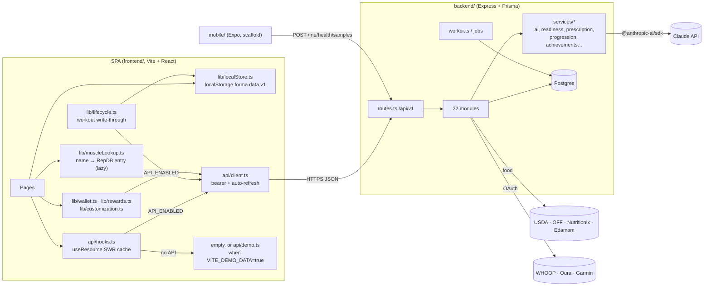

# Forma — Architecture Map

Evidence: static, from imports and route tables (2026-10-30, updated after Milestone 3). Line references are to the files named.

## 1. System overview

**Build-time mode switch:** `API_ENABLED = Boolean(VITE_API_URL)` (`frontend/src/api/hooks.ts:14`). GitHub Pages builds without it, so production is the no-API path.

## 2. Routes → pages → data sources

| Route | Page | Local data (`localStore`) | API calls (API mode) | No-API fallback |
|---|---|---|---|---|
| `/login`, `/signup`, `/forgot-password`, `/reset-password`, `/verify-email` | auth pages | — | `auth.*`, `config.authConfig` | auth disabled; status `anon`, app open |
| `/onboarding` | Onboarding | `saveProfile` | `me.onboarding` | local profile |
| `/dashboard` | Home | sessions, checkins, profile | `dashboard`, `sessions.list` | `buildLocalDashboard` (real local data) |
| `/workouts` | Workouts | sessions, templates, active | `programs.list`, `workouts.generate`, `workouts.list`, `sessions.list` | local templates/presets |
| `/workouts/active` | ActiveWorkout | active session (cache) | `sessions.start/logSet/deleteSet/addPerformance/finish/abandon`, `food.day` | local-only session |
| `/workouts/builder[/:id]` | WorkoutBuilder | local templates | `workouts.create/update` via `lib/templates.ts` | local templates |
| `/trainer` | Trainer | profile | `trainer.get/update`, `chat.history/send/suggestedPrompts`, `programs.generate` | canned replies, empty history |
| `/body` (gated `body_map`) | Body | sessions | `body.muscleMap(range)` | sessions × RepDB muscles (T-10) |
| `/progress` (gated) | Progress | sessions | `sessions.list`, `progress.trainingLoad/patterns/nutritionCorrelation` | local sessions |
| `/records` | Records | sessions | `progress.cohort` | local PRs |
| `/nutrition` | Nutrition → FoodLog / OfflineNutrition | meals, targets | `food.*` | OfflineNutrition (local) |
| `/goals` (gated) | Goals | — | `goals.list/upsert` | empty; adds not persisted (T-23) |
| `/store` (gated) | Store | wallet (localStorage); challenge progress from this week's sessions | `customization.*`, `store.wallet/earn` | local economy |
| `/exercise-library` | ExerciseLibrary | — | none (bundled RepDB catalog) | same |
| `/settings/*` (8) | Settings pages | profile, prefs | `me.*`, `me.devices/connectDevice/syncDevice` | local prefs |
| `/settings/security` | AccountSecurity | — | `me.sessions/revokeSession/changePassword/changeEmail/connectedAccounts/deleteAccount` | n/a |

## 3. Shared components and their consumers

| Component | Consumers | Notes |
|---|---|---|
| `AppShell`, `layout/TopNav`, `layout/QuickActions`, `RouteProgress` | every authed route | AppShell grants the daily coin bonus on mount (`AppShell.tsx:49`) |
| `layout/TrainingTabs` | Body, Progress | |
| `FeatureGate` + `useProgression()` | `main.tsx` gated routes, TopNav, TrainingTabs, Coaching | |
| `BodyMuscles` | Body (`BodyView` also embedded in Workouts) | draws 10 groups; API keys folded in by `lib/fitness.foldToBodyGroups` |
| `lib/muscleLookup.ts` (`useMuscleLookup`, `loadMuscleLookup`) | Body, Progress, Store challenges, ActiveWorkout (detail + summary) | one shared matcher: alias → exact → closest whole-word; aliases live in `lib/repdb.ts` |
| `MuscleMap` (SVG) | legacy | |
| `ExerciseDetailDrawer`, `ExerciseThumb`, `workout/ExercisePicker` | Library, Builder, ActiveWorkout | RepDB catalog |
| `workout/SessionDetailDrawer`, `TemplateCard`, `WorkoutInProgressBar` | Workouts, Home | |
| `dashboard/*` (RingStat, DetailDrawer, MetricDetailBody, GoalsCard, AchievementStrip, Greeting…) | Home | `MetricDetailBody` takes real-data `detail` only; `WeeklySummary` deleted (T-30) |
| `health/*` (DailyCheckin, MetricCard, CircularDial…) | Home | DailyCheckin writes local + `progress.checkin` |
| `nutrition/*` | Nutrition | FoodLog = API, OfflineNutrition = local |
| `EmptyState`, `ErrorState`, `skeleton/*`, `PageHeader`, `Reveal`, `primitives` | most pages | shared, consistent |
| `settings/*` (EditRow, Toggle, SettingsNav, ui) | settings pages | |

## 4. Data ownership (single source of truth)

| Entity | API-mode authority | No-API authority | Consumers | Notes |
|---|---|---|---|---|
| User / profile | `User`, `/me` | `localStore.profile` | Onboarding, TrainingProfile, Settings, Home | |
| Workout sessions | `WorkoutSession`/`ExercisePerformance`/`ExerciseSet` | `localStore.sessions` | Home, Progress, Records, Workouts, ActiveWorkout | API mode keeps a local cache; `apiSessionToCompleted` maps server rows to the local shape |
| Templates | `Workout{isTemplate}` | `localStore.localTemplates` | Workouts, Builder | bridged by `lib/templates.ts` |
| PRs | `PersonalRecord` (server-computed) | derived (`lib/fitness.detectPRs`) | Records, summary | |
| Muscle activation | `/body/muscle-map` | sessions × RepDB muscles | Body | |
| Goals | `Goal`/`GoalEntry` | none; transient state (F-10) | Goals, GoalsCard | sessions auto-increment `weekly_workouts` server-side |
| Achievements | `Achievement`/`UserAchievement` | none | AchievementStrip | server awards coins on unlock |
| Coins / wallet | `Wallet`/`WalletTransaction` | `localStorage forma.wallet.v2` | Store, CoinBalance, Customization | client computes rewards and mirrors (F-02) |
| Weekly challenges | — (client only) | measured from this week's sessions; "claimed" = wallet grant key `<id>:<week>` | Store, workout summary | no separate challenge store since T-37 |
| Cosmetics | `UserCustomization` + server price map | local store | Store, Customization, TopNav, KaiOrb | catalogue duplicated FE/BE (in sync; backend adds `cloud`, `dusk`) — T-31 |
| Food / nutrition | `FoodLog`, `NutritionGoal` | `localStore.meals` | Nutrition, ActiveWorkout (protein nudge) | |
| Check-ins / readiness | `RecoveryCheckin` → `readiness.ts` | `localStore.checkins` | Home, session start adjustment | |
| Chat / Kai memory | `ChatMessage`, `KaiMemory` | none (canned replies) | Trainer | live replies via `services/ai.ts` (SDK, `AI_MODEL`) |

## 5. Change-impact notes for planned work

| Change | Touches | Consumers to re-check | Regression risk |
|---|---|---|---|
| Receipt endpoint hardening | `subscription.ts` | none in frontend; mobile doesn't call it | none |
| Body map fixes | `Body.tsx`, `BodyMuscles.tsx`, `lib/fitness.ts` | `BodyView` embedded in Workouts | visual only |
| Demo data behind a flag | `api/hooks.ts`, Greeting | Goals, AchievementStrip, Trainer, Body; all have empty states | screens now show empty states in the no-API build |
| Wallet seed removal | `lib/wallet.ts` | Store, CoinBalance, Customization | existing users keep stored balances; only fresh installs change |
| Challenges measured from sessions (T-37) | `lib/rewards.ts`, Store, ActiveWorkout | Store challenge cards, workout summary coins | old `forma.challenges.v1` progress is ignored; payouts keep the same wallet keys, so nothing pays twice |
| Shared muscle lookup (T-38) | `lib/muscleLookup.ts`, `lib/repdb.ts` | Body, Progress, Store, ActiveWorkout, thumbnails | better matches change which muscles some sessions count toward |
| CSV export path (T-32) | `backend/src/modules/me.ts` → `/me/export.csv` | Account settings | any other client calling `GET /me/export` for CSV now gets JSON, as it always actually did |
| Server-authoritative rewards (future) | `store.ts`, `sessions.ts`, `goals.ts`, schema, `wallet.ts`, `rewards.ts` | Store, ActiveWorkout summary, AppShell | economy rules — needs approval |
